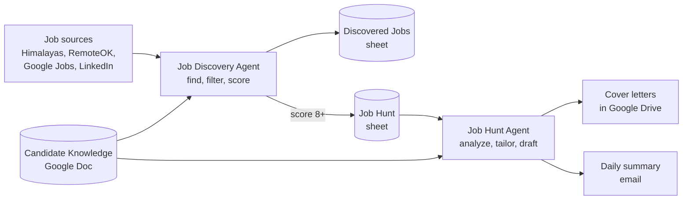

# AI Job Search Agents

Two Google Apps Script agents that automate an executive job search using Claude through the Anthropic API. The **Job Discovery Agent** finds and scores new roles twice a week. The **Job Hunt Agent** turns the strongest matches into ready to review applications every morning, with a fit analysis, tailored resume suggestions, and a draft cover letter.

Both agents read the same **Candidate Knowledge** Google Doc, a single source of truth for the candidate's background, job targets, and writing rules. Every score, analysis, and cover letter is grounded in that document, and the prompts instruct Claude never to invent experience that isn't in it.

## How It Works

### Job Discovery Agent

Runs Monday and Thursday mornings in two stages.

**Discovery.** Searches Himalayas, RemoteOK, Google Jobs (via Serper), and LinkedIn for a configurable list of target titles. It keeps postings from the past seven days, filters out irrelevant and noise titles, removes duplicates, and writes new jobs to the Discovered Jobs sheet.

**Scoring and promotion.** For each unscored job, the agent fetches the posting and runs a deterministic location check first: a role based outside the candidate's home area scores 2 of 10 without an AI call, unless the posting itself says the role can be remote. Remaining jobs are scored 1 to 10 by Claude on how well the actual responsibilities match the candidate's history. Roles scoring 7+ get a fuller analysis with the top talking point, and roles scoring 8+ are promoted to the Job Hunt sheet. A summary email follows.

### Job Hunt Agent

Runs every morning in three steps, each on its own trigger.

1. **Analysis.** Produces a structured assessment of each new pipeline row: fit score, key strengths, watch outs, top talking point, and a suggested status.
2. **Resume tweaks and cover letters.** For strong matches, generates tailored resume suggestions and a cover letter saved as a Google Doc with a standard contact block and sign off.
3. **Daily summary.** Emails pipeline counts by status, the day's new analyses, and the full active pipeline, with flags for letters that need review.

A weekly archive job moves closed, passed, rejected, and stale rows to an Archive tab, while protecting anything in an Interviewing or Offer stage.

## Design Decisions

* **Deterministic checks around the AI.** Rules that matter are enforced in code, not left to the prompt. Location conflicts are resolved before any AI call. Generated cover letters are sanitized automatically and checked against configurable rules, such as a job title that must never be paired with a particular employer. Violations are flagged for human review rather than silently shipped.
* **Single source of truth.** All candidate facts live in one Google Doc sent to Claude as the system prompt. Updating the doc updates every agent's behavior with no code changes.
* **Fail safe.** If the Candidate Knowledge doc can't be loaded, scoring and generation stop entirely rather than running without context.
* **Resilient to platform limits.** Apps Script executions cap at six minutes. The Discovery Agent schedules its own continuation when a run nears the limit and resumes at the next unscored row, with a continuation cap and a no progress check to prevent runaway chains.
* **No secrets or personal data in code.** API keys, IDs, contact details, search targets, prompts, and rule checks all live in Apps Script Script Properties. The code is fully generic, and prompts can be tuned without a code change.
* **Safe by default operations.** The archive writes rows to the Archive tab before deleting them from the pipeline, and a preview function shows exactly what would move before anything changes.

## Tech Stack

* Google Apps Script (JavaScript, V8 runtime)
* Anthropic API (Claude Haiku by default, configurable per task)
* Google Sheets, Docs, and Drive
* Serper API for Google Jobs search

## Getting Started

Setup takes about an hour and requires a Google account, an Anthropic API key, and a Serper API key. Full step by step instructions, including sheet layouts, every Script Property, prompt templates, a Candidate Knowledge template, triggers, and troubleshooting, are in the [Setup Guide](docs/Job_Search_Agents_Setup_Guide.docx). A shorter [Overview](docs/Job_Search_Agents_Overview.docx) is also included.

In brief:

1. Create the Discovered Jobs and Job Hunt spreadsheets, the Candidate Knowledge doc, and a Cover Letters folder.
2. Create two separate Apps Script projects and paste in `job_discovery_agent.js` and `job_hunt_agent.js`.
3. Add the required Script Properties to each project.
4. Authorize, run the included test functions, and create the time driven triggers.

## Repository Contents

| File | Description |
|---|---|
| `job_discovery_agent.js` | Job Discovery Agent |
| `job_hunt_agent.js` | Job Hunt Agent |
| `docs/Job_Search_Agents_Setup_Guide.docx` | Step by step setup guide |
| `docs/Job_Search_Agents_Overview.docx` | Summary of both agents |

## Important Notes

* **Generated content is a draft.** Always read analyses and cover letters in full before using them.
* **LinkedIn.** The Discovery Agent fetches LinkedIn's public job search pages, which are frequently blocked and may be restricted by LinkedIn's terms of service. Users are responsible for complying with the terms of every source they enable. When LinkedIn blocks a request, the agent logs it and continues with the other sources.
* **Costs.** The agents make Anthropic API and Serper calls on a schedule. Set a monthly spend limit in the Anthropic Console, and use a separate API key for each agent.
* **Privacy.** Keep your Candidate Knowledge doc, sheets, and Apps Script projects private. Anyone with editor access to a project can read its Script Properties.

## License

Released under the [MIT License](LICENSE).

